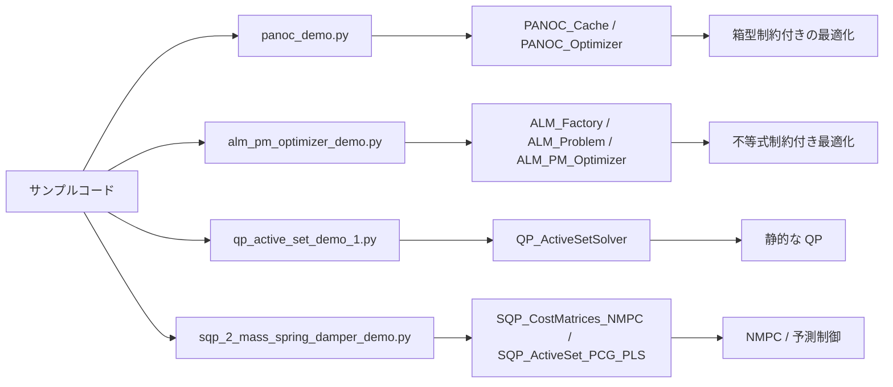

# Python Optimization ライブラリの利用ガイド

このドキュメントは、`sample/` フォルダにあるコードを読んで「どのクラスをどう使えばよいのか」を理解するための入門ガイドです。

内部の数式や反復計算の詳細に踏み込みすぎず、まずは「どんな問題に対してどのクラスを選ぶのか」「初期値と制約をどう渡すのか」を中心に説明します。

## このリポジトリが解く問題の大まかな分類

- Box 制約付きの非線形最適化
  - `PANOC_Optimizer`
- 不等式制約付きの非線形最適化
  - `ALM_PM_Optimizer`
- 固定の二次計画問題（QP）
  - `QP_ActiveSetSolver`
- 制御問題向けの SQP / NMPC
  - `SQP_ActiveSet_PCG_PLS` など

## 代表的なサンプルと対応する使い方

| サンプル | 役割 | メインのクラス |
|---|---|---|
| `sample/panoc_demo.py` | 変数に上下限がある問題を解く | `PANOC_Cache`, `PANOC_Optimizer` |
| `sample/alm_pm_optimizer_demo.py` | 出力制約（例: `u0 + u1 <= 1`）を持つ問題を解く | `ALM_Factory`, `ALM_Problem`, `ALM_PM_Optimizer` |
| `sample/qp_active_set_demo_1.py` | 2変数の QP を最適化 | `QP_ActiveSetSolver` |
| `sample/sqp_2_mass_spring_damper_demo.py` | 2 mass spring damper の NMPC | `SQP_CostMatrices_NMPC`, `SQP_ActiveSet_PCG_PLS` |
| `sample/sqp_pendulum_demo.py` | 振り子系の NMPC | `SQP_CostMatrices_NMPC`, `SQP_ActiveSet_PCG_PLS` |

## 読み進め方

1. まず [01-quick-start.md](01-quick-start.md) で「サンプルが何を作っているか」を掴む
2. 次に [02-panoc-and-alm.md](02-panoc-and-alm.md) で、制約付き最適化の違いを知る
3. 最後に [03-qp-and-sqp.md](03-qp-and-sqp.md) で、制御問題向けの使い方を見る

## 重要な前提

- ここでの説明は、問題を「最適化の入口」として捉えることを重視します
- 変数の上下限、制約関数、コスト関数、初期値が揃えば、各クラスを使う流れがほぼ同じです
- すべての数式を追う必要はなく、サンプルコードを何度か書き換えて試すことで理解が進みます

## まずはどれから触るべきか

- 「箱型の制約だけがある」なら `PANOC_Optimizer`
- 「出力制約や不等式制約を扱いたい」なら `ALM_PM_Optimizer`
- 「静的な QP の最適化をしたい」なら `QP_ActiveSetSolver`
- 「制御入力列を一気に最適化したい」なら `SQP_ActiveSet_PCG_PLS`

次のページから、各クラスの使い方を具体例に沿って見ていきます。
